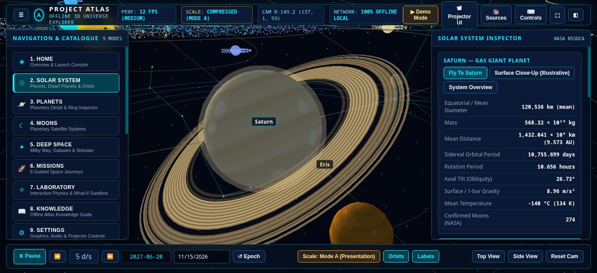
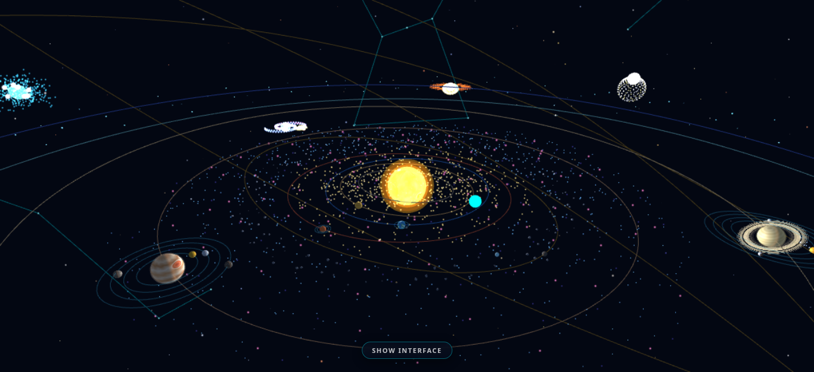
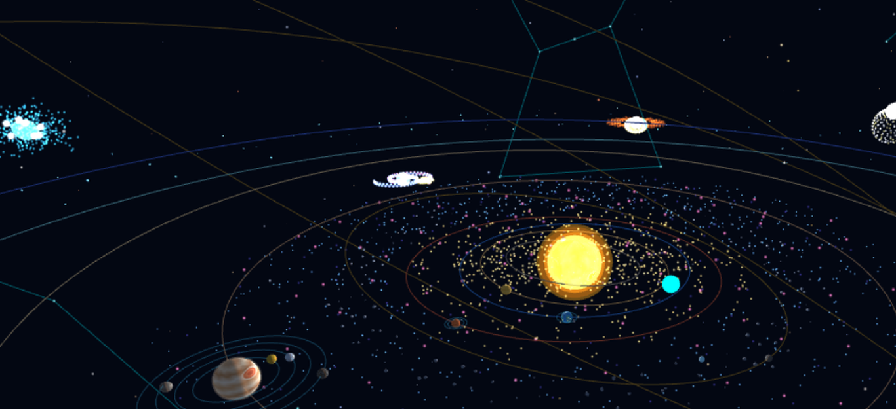

# PROJECT ATLAS — Interactive 3D Universe Explorer (`v2.0.0-CINEMATIC-ULTRA`)

> **Explore the Solar System. Understand the Universe. Discover Our Place in Space.**  
> A 100% offline, hardware-accelerated 3D WebGL universe exploration simulator and college science fair exhibition package engineered to run smoothly on standard classroom laptops (HP ProBook 640 · Intel Core i5-6300U · 8 GB RAM · Integrated GPU) and 32–40 inch projectors.

---

## Live Application Previews

### 1. Mission-Control Interface & Planetary Inspector


### 2. Unobstructed Cinematic View (`◉ CINEMATIC VIEW` / `H` Shortcut)


### 3. Deep Space, Constellations & Hubble Messier Catalog


---

## Key Features

- **100% Offline Runtime (`0` External Network Requests):** All 3D rendering engines, procedural 4-octave Fractional Brownian Motion (`fBm`) planetary/moon textures, custom GLSL atmospheric and solar corona shaders, Web Audio ambient synthesizer, and 8 verified NASA/IAU JSON datasets are bundled locally.
- **Unobstructed Cinematic Mode (`◉ CINEMATIC VIEW` or `H` Key):** Smoothly hides all toolbars, sidebars, floating labels, and banners to showcase the pure 3D universe with an auto-fading `◉ SHOW INTERFACE (H / ESC)` restore pill.
- **42 Selectable 3D Celestial Objects Across 9 Modes:**
  1. **Home & Overview** — Quick-launch console and telemetry overview
  2. **Solar System** — The Sun, 8 classical planets, 5 IAU dwarf planets, Main Asteroid Belt (`4 Vesta`), Kuiper Belt, and conceptual Oort Cloud
  3. **Planets & Ring Inspector** — Ultra-detail surfaces, atmospheric scattering, and Saturn's `D`, `C`, `B`, `Cassini Division`, `A`, and `F` rings
  4. **Moons** — 18 individually modeled planetary moons (`Luna`, `Phobos`, `Deimos`, `Io`, `Europa`, `Ganymede`, `Callisto`, `Titan`, `Enceladus`, `Mimas`, `Rhea`, `Iapetus`, `Miranda`, `Ariel`, `Umbriel`, `Titania`, `Oberon`, `Triton`)
  5. **Deep Space** — Barred-spiral Milky Way (`SBbc`), `Sagittarius A*`, Solar Neighborhood marker (`~26,000 ly`), 5 constellations, and 9 Hubble Messier objects (`M1`, `M8`, `M13`, `M16`, `M31`, `M42`, `M45`, `M51`, `M104`)
  6. **Guided Space Missions** — 5 interactive 3D spacecraft trajectories along `CatmullRomCurve3` splines
  7. **Astronomy Laboratory** — Non-destructive physics sandbox (Scale Modes A & B, Planetary Gravity & Size Comparator, Axial Tilt & Seasons Simulator, Habitability Explorer)
  8. **Offline Knowledge Guide** — Deterministic search across 22 curated Q&A cards and glossary entries
  9. **Settings & Performance** — Adaptive `LOW` / `MEDIUM` / `HIGH` graphics presets, automatic FPS governor, and High-Contrast Projector UI

---

## Instant Launch (Zero Install Required)

1. **Single-File Standalone Build:** Double-click [`PROJECT_ATLAS_CINEMATIC_ULTRA.html`](PROJECT_ATLAS_CINEMATIC_ULTRA.html) (or `dist/PROJECT_ATLAS_CINEMATIC_ULTRA.html`) in any modern browser (Chrome, Edge, Brave, Firefox). No local server or internet connection is needed.
2. **Windows Launcher:** Double-click `run_atlas.bat`.
3. **Rebuild & Run Verification Suite (Optional with Node.js):**
   ```bash
   node scripts/build-standalone.js
   node tests/run-all-tests.js
   ```

---

## Keyboard Shortcuts

| Key | Action |
| :--- | :--- |
| `H` | Toggle unobstructed **Cinematic View** (hide/restore all UI panels) |
| `Escape` | Exit Cinematic View, close modal dialogs, or stop automated demo |
| `Space` | Play / Pause orbital time simulation |
| `F` | Toggle fullscreen mode |
| `R` | Reset camera to Solar System overview |
| `1` – `5` | Switch camera presets (Overview, Top Ecliptic, Side Plane, Inner System, Outer System) |
| `W` `A` `S` `D` + `Q` `E` | Free-flight 3D camera movement |

---

## Repository Structure

```text
PROJECT_ATLAS/
├── PROJECT_ATLAS_CINEMATIC_ULTRA.html   # Single-file 100% offline standalone build
├── index.html                           # Modular entry point
├── src/                                 # Modular 3D engine, solar system, moons, missions, lab & UI
├── public/data/                         # 8 verified NASA NSSDCA / IAU / Hubble Messier JSON datasets
├── dist/                                # Compiled distribution & standalone bundle
├── screenshots/                         # High-resolution captures from live application
├── presentation/                        # 36-slide Science Fair Presentation (.pptx & .pdf)
├── scripts/build-standalone.js          # Standalone single-file HTML compiler
├── tests/run-all-tests.js               # 18 automated unit & offline-audit tests
├── UPLOAD_TO_GITHUB.bat                 # One-click GitHub push helper for Windows
└── upload_to_github.sh                  # One-click GitHub push helper for Linux
```

---

## Scientific Sources & Credits

- **Planetary & Lunar Data:** [NASA Goddard Space Flight Center — NSSDCA Planetary Fact Sheet (Metric)](https://nssdc.gsfc.nasa.gov/planetary/factsheet/) & [Satellite Fact Sheets](https://nssdc.gsfc.nasa.gov/planetary/planetfact.html)
- **Dwarf Planets & Small Bodies:** [NASA Science — Dwarf Planets](https://science.nasa.gov/dwarf-planets/) & [Solar System Facts](https://science.nasa.gov/solar-system/solar-system-facts/)
- **Deep Space & Nebulae/Galaxies:** [NASA Science — Hubble Messier Catalog](https://science.nasa.gov/mission/hubble/science/explore-the-night-sky/hubble-messier-catalog/)
